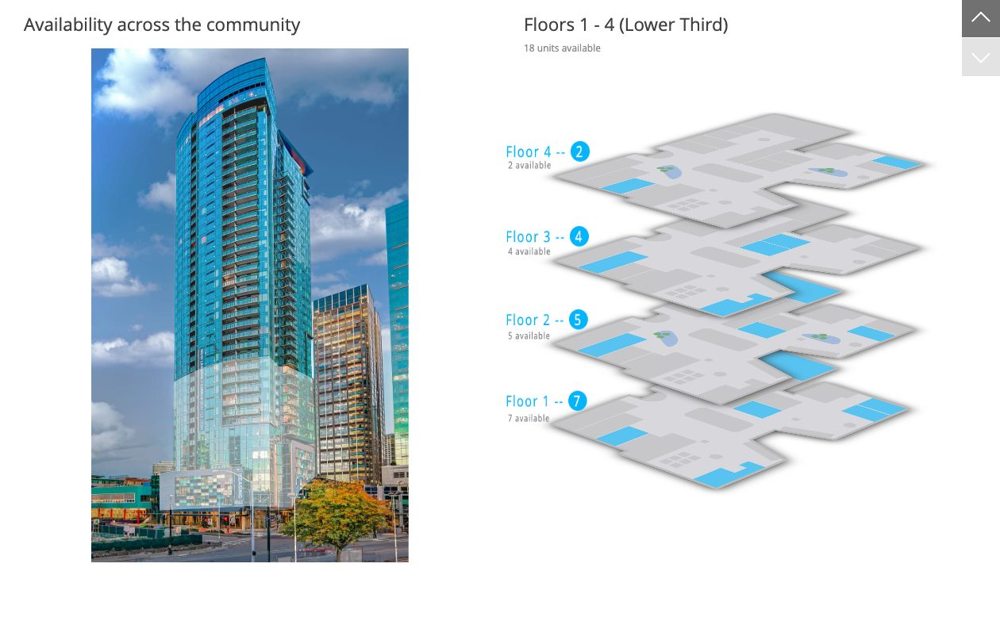

# Interactive Site Map

A front-end prototype for apartment discovery. Instead of opening a separate listing for each unit, prospective renters can start with the building, choose a group of floors, and see which units are available directly on an interactive floor plan.

**[Explore the live prototype](https://musical-gnome-22e64f.netlify.app/)** · [Run locally](#run-locally)

**JavaScript · jQuery · SVG · CSS transitions**

Built by **[Maria Blair](https://github.com/mashablair)**. A real-estate UI study in making spatial information, availability, and filtering understandable in one interface.



*Captured from the working local preview in November 2026, after verifying the deployed prototype. The original project dates to 2018; availability and prices are illustrative.*

## What to look at

- **Building-to-unit navigation.** The building overview summarizes availability by section. Selecting a section opens its floor plans, where available units are highlighted and labeled.
- **Filters that carry through the views.** Bedroom count and maximum rent narrow the matching units and update availability counts in the building overview and floor view.
- **Custom SVG interactions.** The floor plan is composed of SVG shapes associated with unit metadata. CSS handles the perspective and transitions; JavaScript connects the shapes, filters, and summary counts.

## Run locally

This is a static HTML, CSS, SVG, and JavaScript/jQuery prototype. It does not need a backend, credentials, or a build step.

```sh
git clone https://github.com/mashablair/interactive-site-map.git
cd interactive-site-map
python3 -m http.server 8000
```

Open [localhost:8000](http://localhost:8000/). Choose a building section, move between floors, then try a bedroom or rent filter. The prototype uses legacy libraries and externally hosted styles/assets, so internet access is needed even for local preview.

## Code map

| File | What it contains |
| --- | --- |
| [`index.html`](index.html) | Property overview, filter controls, SVG floor plans, and illustrative unit metadata |
| [`main.js`](main.js) | View changes, floor navigation, filtering, and availability counts |
| [`interractive-site-map.css`](interractive-site-map.css) | Layout, map styling, and transitions |

## Scope

The working interactions are building-section selection, floor navigation, bedroom filtering, and maximum-rent filtering. Other controls and leasing links belong to the original UI mockup; this is not a connected inventory or leasing system.

[Verification notes](docs/PORTFOLIO_CHECK.md) describe the current browser checks.
